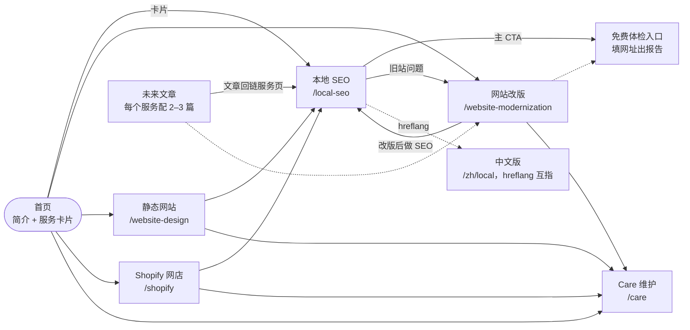

# Northline 服务页内容设计规范

原文页面：<https://cursor.com/canvas/store-ed09fe6d-7d5b-4521-a08e-ae263b5ba4ab/c7256dc5-5364-4fd9-b49b-6f4752adc86e>

每个服务页都按同一个模板写：10 个内容模块、15 项 SEO 硬性要求、各服务的定制内容，再按清单验收。目的是让搜某项服务的人落在对应的那一页，而不是一个泛泛的工作室首页。

## 目录

- [设计原则](#设计原则)
- [一、通用页面模板](#一通用页面模板)
- [二、每页 SEO 硬性要求](#二每页-seo-硬性要求)
- [三、各服务页的定制内容](#三各服务页的定制内容)
- [四、内链结构](#四内链结构)
- [五、上线前验收清单](#五上线前验收清单)
- [六、现状问题对应关系](#六现状问题对应关系)

## 设计原则

Google 排的是单个页面。一个页面只服务一个服务、一组搜索词，写足内容，互相之间用内链连起来，这样搜「SEO」的人落在 SEO 页，搜「website modernization」的人落在改版页。

1. 一页一个服务，一组主关键词，页面之间不抢词。
2. 不写任何具体价格；价格模块只讲「怎么报价」，引导客户来问。
3. 不用「小店」二字，统一用「门店」或「本地商家」。
4. 不展示作品，所以信任来自流程、书面承诺、体检和前后指标、FAQ、创始人背景。
5. 不承诺排名，只承诺交付物、流程和衡量方式。
6. 页面上所有关键词都是建议词，需要用关键词工具（如 Search Console 的真实查询、DataForSEO）验证搜索量后再定，本文没有写任何搜索量数字。

> **目标市场**
>
> 主要面向西雅图地区的本地商家，同时保留面向全美的可能：页面用「Seattle」做主地区词，正文再写明可远程服务的范围。

## 一、通用页面模板

从上到下的顺序即页面顺序；篇幅是建议值，不是硬指标。

| 模块 | 目的 | 写什么 | 篇幅 | SEO 要求 |
| --- | --- | --- | --- | --- |
| 1. 首屏 Hero | 3 秒内让人知道这页卖什么、卖给谁、下一步点哪里 | H1 = 服务名 + 地区；一句话价值；两个按钮：预约沟通 + 次要入口（如私信「检查」或免费体检）；一行信任小字（如「按流程交付，不靠作品集」） | 首屏文字 30–60 字 | 全站唯一 H1，含主关键词和 Seattle；按钮是 HTML 链接（tel / mailto / 预约链接），不要做成图片或只靠脚本生成 |
| 2. 适合谁 / 痛点 | 让目标客户觉得「这就是在说我」，也筛掉不合适的人 | 3–4 个具体场景，用门店老板的话写，例如「Google 地图上搜不到自己」「网站手机上打不开」；末尾一句「不适合谁」 | 100–150 字 | H2 带服务词；痛点词自然出现，作为次要关键词的落点 |
| 3. 包含什么（交付物） | 把服务拆成能验收的东西，而不是形容词 | 6–8 项交付物清单，每项「名词 + 一句话说明」；不写「全方位」「一站式」这类空话 | 150–250 字 | H2 + 列表（HTML 的 ul / li）；主关键词和 2–3 个次要关键词在这里自然出现 |
| 4. 流程 | 降低「不知道会发生什么」的焦虑，同时是无作品集下的第一信任来源 | 4–6 步，每步写：做什么、客户要提供什么、大概多久 | 100–200 字 | H2 + 有序列表；可加 HowTo 文字结构，但不依赖 HowTo 富结果 |
| 5. 你会看到什么（可见成果） | 把看不见的工作变成看得见的东西 | 3–5 种成果物，每种配一张图：体检报告、前后对比截图、周报或月报样例、Google 地图排名热力图（SEO）等；图里数据先脱敏 | 100–150 字 + 3 张图 | 每张图都有描述性 alt（写图里是什么，不堆关键词）；文件名用英文短横线，如 `local-seo-audit-report.png` |
| 6. 为什么选我们（不靠作品集） | 回答「凭什么信你」；站点定位是不展示作品，所以信任靠过程、承诺和可核对的数据 | 四类证据：1 固定流程和交付清单；2 书面保证或验收标准；3 体检和前后指标（如 PageSpeed、Core Web Vitals）；4 创始人背景和联系方式。可公开的客户评价可以放，但不是必需项 | 100–200 字 | 创始人段落用真实姓名和职业背景（是否公开 MongoDB 背景由 Peter 决定）；这段是 E-E-A-T 的主要落点 |
| 7. 怎么报价 | 不放数字，但要讲清楚价格怎么来，引导客户来问 | 三件事：影响报价的 3 个因素（页数、功能、现状）；报价前我们会先做什么（免费沟通或体检）；怎么拿到报价（按钮 + 回复时间） | 60–100 字 | 全页不出现任何金额、折扣、「起」「约」价格字样；标题用「如何报价」而不是「价格」 |
| 8. 常见问题 FAQ | 回答成交前最后的顾虑，同时覆盖长尾搜索词和 AI 搜索的提问 | 5–8 个问题，每个答案 40–80 字，先给结论再解释；至少 1 个问「多久见效」、1 个问「不保证排名怎么办」类的坦诚问题 | 300–500 字 | 页面上可见的 HTML 文本，不要折叠到要点击才加载；可加 FAQPage 标记，但 2023 年起 Google 对它的富结果展示已基本限于政府和健康类，所以当作内容和 AI 引用素材，不当作排名手段 |
| 9. 相关服务（内链） | 把有需求的人送到下一个页面，同时给每个服务页传权重 | 2–4 个相关服务卡片，每个一句话说明「什么时候该看它」 | 每条 20–40 字 | 锚文字直接用服务名（如「本地 SEO 服务」），不用「了解更多」「点击这里」；至少 3 条站内链接，含首页和面包屑里的上级 |
| 10. 页尾 CTA | 读完的人不用回头找按钮 | 重复首屏主 CTA；附联系方式（邮箱、电话、预约链接）和服务地区；一句话承诺回复时间 | 40–80 字 | 联系信息与 Google 商家资料完全一致（NAP）；用 HTML 文本，不用图片 |

## 二、每页 SEO 硬性要求

与 Layer 1 的页面检查项（P 系列）对齐；这里的 S 编号只是本规范内部引用用。

| 编号 | 项目 | 达标标准 | 怎么验 |
| --- | --- | --- | --- |
| S1 | 唯一的 title | 不超过 60 个字符，格式「主关键词 + 城市 \| Northline Studio」；全站没有重复 | 看源码或用爬虫导出 title 列表 |
| S2 | meta description | 不超过 155 个字符；写卖点和行动，含主关键词和城市；每页不同 | 爬虫导出，检查长度和重复 |
| S3 | 一个 H1 | 每页只有一个 H1，含服务名和地区，与 title 相关但不必完全相同 | 爬虫的 H1 列：数量 = 1 |
| S4 | 正文长度 | 英文页 600 词以上；中文页 1000 字以上；以对读者有用为准，不凑字数 | 爬虫的 word count |
| S5 | 图片和 alt | 至少 3 张真实图片（流程图、报告截图、对比图、创始人照），每张有描述性 alt；首屏以外的图用懒加载；有宽高避免版面跳动 | 爬虫的图片列表；Lighthouse 无 CLS 警告 |
| S6 | 内链 | 至少 3 条站内链接，锚文字描述目标页内容；首页卡片链到本页；本页链回首页和相关服务 | 爬虫的 inlinks / outlinks 报表 |
| S7 | 首屏行动入口 | 电话、邮件、预约或私信入口出现在 HTML 首屏，不靠脚本生成 | curl 页面源码，搜 `tel:`、`mailto:`、预约链接 |
| S8 | Service 结构化数据 | 每页一个 `Service`（name、description、areaServed、url），通过 `provider` 指向站点的 `ProfessionalService`，两者用同一个 `@id` 对上 | Google Rich Results Test 和 Schema Markup Validator 都无错误 |
| S9 | FAQ 区块 | 页面上有可见的 FAQ；可加 FAQPage 标记，但不指望富结果 | 人工看；标记通过验证 |
| S10 | canonical | 每页自带 canonical，指向自己的最终网址（含 https、统一是否带斜杠） | 源码检查；GSC 网址检查里「用户声明」与「Google 选择」一致 |
| S11 | 进 sitemap | 本页在 `sitemap.xml` 里，`lastmod` 准确；sitemap 已提交 Search Console 和 Bing | 打开 sitemap 找到本页；GSC 的站点地图报告无错误 |
| S12 | hreflang | 有中文版的页面，中英文版互相标注，并加 `x-default`；没有中文版就不加 | 源码检查；双向都有 |
| S13 | 面包屑 | 页面上有可见面包屑（首页 > 服务名），并加 BreadcrumbList 标记 | Rich Results Test |
| S14 | 可抓取和可索引 | 没有 noindex，没被 robots.txt 挡住；返回 200；全程 https | GSC 网址检查；curl 看状态码 |
| S15 | 速度和移动端 | 移动端 LCP 不超过 2.5s、INP 不超过 200ms、CLS 不超过 0.1；手机上按钮可点 | Lighthouse 和 PSI；上线后看 CrUX 真实数据 |

## 三、各服务页的定制内容

关键词全部是待验证的建议；中文页另做一版，不是英文页直译。

| 服务 | 网址 | 主关键词（待验证） | 主 CTA |
| --- | --- | --- | --- |
| 本地 SEO | /local-seo | Seattle local SEO | 免费体检 / 私信「检查」 |
| 网站改版 | /website-modernization | small business website redesign Seattle | 预约沟通 |
| 静态网站 | /website-design | small business website design Seattle | 预约沟通 |
| Shopify 网店 | /shopify | Shopify developer Seattle | 预约沟通 |
| Care 维护 | /care | website maintenance for small business Seattle | 预约沟通 |

### 本地 SEO

**建议网址**

`/local-seo`；中文版对应 `/zh/local`（确认内容对应后互相加 hreflang）

**主关键词（待验证）**

Seattle local SEO；local SEO for small business Seattle

**次要关键词（待验证）**

Google Business Profile optimization Seattle；local SEO audit；本地商家 SEO；西雅图华人商家 Google 地图排名

**H1 建议**

Local SEO for Seattle Businesses：让附近的客人在 Google 地图上找到你

**核心痛点**

附近搜索时看不到自己；Google 商家资料没人管；不知道钱花在哪、有没有效果；之前的 SEO 只收费不汇报

**重点交付物**

免费体检报告；基线对比；Google 商家资料优化；NAP 统一和目录引用；站内关键词和 schema 调整；地图网格排名热力图；周报和月报；AI 搜索提及检查

**独有信任点**

免费体检报告样例（可直接给人看的真实结构）+ 90 天承诺卡片：写明承诺交付的清单、衡量指标、未达标时的补救办法（第 4 个月免维护费），并列出不在保证范围内的因素。不承诺具体排名

**FAQ 问题建议**

多久能看到变化？为什么你们不保证排第一？免费体检包含什么、会不会骗我留资料？我没有 Google 商家资料怎么办？90 天后做什么？和 Care 维护有什么区别？

**CTA**

主：免费体检（填网址即可）；次：私信「检查」；第三：预约沟通

**要链接的页面**

网站改版（体检常发现旧站问题）；Care 维护；首页；未来的「门店怎么做本地 SEO」系列文章

### 网站改版

**建议网址**

`/website-modernization`

**主关键词（待验证）**

small business website redesign Seattle；website redesign for local business

**次要关键词（待验证）**

outdated website refresh；old website not mobile friendly；improve website speed；旧网站改版；本地商家网站翻新

**H1 建议**

Website Redesign for Seattle Small Businesses：旧网站换新，不丢已有排名

**核心痛点**

手机上难用、加载慢；看起来是十年前的；换网站怕丢掉现有 Google 流量；原来的建站人联系不上

**重点交付物**

现状诊断；网址对照表和 301 重定向；移动端优先的新设计；速度优化；保留并改进原有 SEO 内容；新站上线前后对比；上线后一个月观察期

**独有信任点**

前后 PageSpeed 和 Core Web Vitals 对比（用真实脱敏截图或演示数据，标明测量方式）；改版前的基线快照，以及「不丢流量」的 301 清单流程

**FAQ 问题建议**

改版会不会掉排名？需要多久？旧网站的内容和域名能保留吗？我现在的网站是别人建的，能接手吗？改版后还要付维护费吗？

**CTA**

主：预约沟通；次：免费体检你现在的网站（引到 SEO 体检）

**要链接的页面**

本地 SEO；静态网站（若只需要简单展示）；Shopify（若是网店）；Care 维护；首页

### 静态网站

**建议网址**

`/website-design`（先确认对外称呼是「静态网站」还是「门店官网」，页面用客户会搜的词）

**主关键词（待验证）**

small business website design Seattle；affordable website for local business（页面上不出现任何价格，此词仅作搜索意图参考，是否使用待定）

**次要关键词（待验证）**

fast website for local business；simple business website；website for restaurant / salon / clinic；本地商家官网；门店官网制作

**H1 建议**

Small Business Website Design in Seattle：打开快、手机好用、能被搜到的门店官网

**核心痛点**

没有官网，只靠社交账号；模板站又慢又丑；不知道官网上该放什么；建站后没人管

**重点交付物**

页面结构规划；移动端优先设计；联系方式、地图、预约入口；基础 SEO 设置（title、sitemap、schema）；追踪设置（GA4 和转化事件）；上线后的验收报告

**独有信任点**

速度和基础 SEO 达标证明：上线时给客户一份验收报告，对照本规范的 S1–S15；静态站的稳定和加载速度说明

**FAQ 问题建议**

做一个官网要多久？需要我提供什么？以后改内容怎么办？官网能不能自己更新？上线后能在 Google 搜到吗？

**CTA**

主：预约沟通；次：免费体检（若已有旧站）

**要链接的页面**

网站改版（已有旧站）；本地 SEO（建完站就该做的下一步）；Care 维护；首页

### Shopify 网店

**建议网址**

`/shopify`

**主关键词（待验证）**

Shopify developer Seattle；Shopify store setup for small business

**次要关键词（待验证）**

Shopify store build for local retailer；Shopify store speed optimization；Shopify 建站；本地商家开网店

**H1 建议**

Shopify Store Build for Seattle Businesses：从上架到收款，一次配好

**核心痛点**

想把线下生意搬一部分到线上，不知道从哪开始；网店装好没有订单；产品页没人搜得到；支付、运费、税设置复杂

**重点交付物**

店铺搭建和主题定制；产品、分类和页面结构；支付、运费、税设置；产品页 SEO 基础（标题、描述、图片 alt、Product schema）；订单和转化追踪；上线检查清单；操作培训

**独有信任点**

上线验收清单（支付测试、移动端、速度、追踪都验过）；店铺速度基线对比；流程透明，客户拥有自己的店铺账号和数据

**FAQ 问题建议**

我需要自己有产品图吗？Shopify 的费用由谁付、付给谁？（只讲结构，不写金额）店铺归谁？上线后你们还管吗？能和我现在的线下收银对接吗？

**CTA**

主：预约沟通；次：私信「店铺」或免费体检

**要链接的页面**

本地 SEO（有线下门店时）；Care 维护；网站改版（已有旧网店）；首页

### Care / Care Plus 月度维护

**建议网址**

`/care`，两档放在同一页，不拆成两页，避免互相抢词

**主关键词（待验证）**

website maintenance for small business Seattle；monthly website care plan

**次要关键词（待验证）**

website maintenance service；website updates and backups；网站维护；本地商家网站托管和更新

**H1 建议**

Website Care Plans for Seattle Businesses：网站交给我们，每月有记录可查

**核心痛点**

网站建完没人管；出问题找不到人；插件和系统一直不更新；想改个电话或营业时间都要等很久

**重点交付物**

两档用同一张对比表列出：备份、安全更新、可用性监控、内容修改次数、速度检查、月度报告；Care Plus 多出的项目单独标出。不写价格

**独有信任点**

每月工作记录和报告样例；响应时间承诺（写明工作日内回复）；不绑长约（若确实如此再写）

**FAQ 问题建议**

Care 和 Care Plus 区别是什么？每月能改多少内容？网站被黑了怎么办？不是你们建的网站能接吗？能随时取消吗？和本地 SEO 维护是一回事吗？

**CTA**

主：预约沟通，问哪一档适合；次：免费体检

**要链接的页面**

本地 SEO（SEO 维护是独立服务，不含在 Care 里，页面要写清楚）；网站改版；静态网站；Shopify；首页

## 四、内链结构

实线是主要链接，虚线是次要链接。

1. 首页只保留简介和服务卡片，卡片链到五个服务页，锚文字用服务名。
2. 每个服务页都链回首页，并链到 2–4 个相关服务页。
3. 本地 SEO 页的主 CTA 指向免费体检入口，体检报告末尾再引导回 SEO 页或预约。
4. 改版、静态网站、Shopify 三页都推荐「建完站做 SEO」和「建完站用 Care」。
5. 未来每个服务配 2–3 篇文章，例如「门店怎么做本地 SEO」，文章必须链回对应服务页，服务页也挑最相关的文章回链。
6. 有中文版的页面和英文版互相加 hreflang，并各自链到同语言的相关页面。

## 五、上线前验收清单

每个服务页上线前逐项核对，全部通过才合并发布。

| 类别 | 检查项 | 怎么验 |
| --- | --- | --- |
| 内容 | title、description、H1 逐项对照 S1–S3，没有超长和重复 | 爬虫导出核对 |
| 内容 | 全页没有任何金额、折扣或「起」「约」价格字样；没有「小店」二字 | 全文搜索 `$`、`USD`、`起`、`小店` |
| 内容 | 没有承诺排名或「保证第一页」「一定见效」之类的话；SEO 页的 90 天保证措辞经 Peter 确认 | 人工通读 |
| 内容 | 10 个模块都在，次序对；FAQ 5 条以上；没有占位文字 | 对照第一部分的模板表 |
| 内容 | 不展示作品的定位一致：没有作品集画廊，信任部分用流程、保证、数据、创始人 | 人工通读 |
| 技术 | 单个 H1；图片 3 张以上且有 alt；内链 3 条以上，锚文字不是「了解更多」 | 爬虫报表 |
| 技术 | Service 和 BreadcrumbList（以及有 FAQ 时的 FAQPage）标记无错误；provider 指向 ProfessionalService | Rich Results Test |
| 技术 | canonical 正确；200 状态码；无 noindex；http 跳转到 https；有中文版时 hreflang 双向 | curl 和 GSC 网址检查 |
| 技术 | 移动端 LCP ≤ 2.5s、CLS ≤ 0.1，手机上按钮和电话能点 | Lighthouse，真机看一遍 |
| 收录 | 本页在 sitemap；已在 GSC 提交网址并请求编入索引；首页卡片和相关页已链到本页 | GSC 站点地图和网址检查 |
| 转化 | 首屏 CTA 可点；表单或私信入口测试过；GA4 事件和 UTM 能记录；通知邮件能收到 | 实际点一遍，查 GA4 实时报告 |
| 上线后 7 天 | GSC 里该页已被收录；展示次数开始出现；没有新的覆盖率错误 | GSC 网址检查和效果报告 |

1. **写完内容**

   按第一部分的模板写，关键词用第三部分的建议词。

2. **技术自检**

   跑爬虫和 Lighthouse，对照 S1–S15。

3. **Peter 过目**

   重点看无价格、无「小店」、无排名承诺、SEO 保证措辞。

4. **上线并提交**

   加进 sitemap，在 Search Console 提交网址。

5. **7 天后复查**

   看收录和展示，记入工作记录，再决定是否调整 title 和内容。

## 六、现状问题对应关系

nlstudio.io 基线审计里发现的问题，由本规范的哪一项来解决。

| 现状问题 | 怎么解决 | 对应项 |
| --- | --- | --- |
| sitemap 只有首页 | 每个服务页上线时同步进 sitemap，并重新提交 | S11 |
| 0 张图片 | 每页至少 3 张真实图片，带 alt | S5 |
| 0 条内链 | 首页服务卡片链到各页；各页互链；加面包屑 | S6、S13 |
| title 和 description 缺关键词和城市 | 按每页的主关键词和城市重写 | S1、S2 |
| HTML 里没有联系入口 | 首屏和页尾都放 tel、mailto 或预约链接 | S7 |
| 结构化数据只有 ProfessionalService | 每页加 Service，provider 指回 ProfessionalService | S8 |

> **需要 Peter 确认**
>
> SEO 页的 90 天保证最终措辞（指标百分比、N 个关键词、未达标时的补救）还没定；定之前页面只写「承诺交付清单 + 衡量方式 + 免费体检」，不写具体数字。
